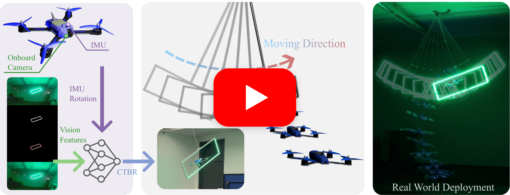

<div align="center">

# Learning Visuomotor Quadrotor Flight Through Dynamic Narrow Gaps

[Riccardo Bianco](linkedin.com/in/riccardo-bianco-2a0657297)\* &nbsp;·&nbsp;
[Yunfan Ren](https://renyunfan.github.io/)\* &nbsp;·&nbsp;
[Jiaxu Xing](https://jiaxux.ing/) &nbsp;·&nbsp;
[Davide Scaramuzza](https://rpg.ifi.uzh.ch/people_scaramuzza.html)

*Robotics and Perception Group, University of Zürich*

<sub>\* Equal contribution</sub>

**Conference on Robot Learning (CoRL) 2026**

</div>

> A differentiable simulation framework that learns to thread a quadrotor through a **moving narrow gap** from onboard vision and inertial measurements alone — no teacher, no planner, no distillation. Policies train from scratch to a **99.3 %** success rate in simulation within **minutes on a single GPU**, and transfer zero-shot to a real quadrotor.

<p align="center">
  <a href="https://youtu.be/I72C1Jdeluw">
    
  </a>
</p>

## 📄 Citation

If you find our work and/or code useful, please cite our paper:

```bibtex
@inproceedings{bianco2026visuomotor,
  title     = {Learning Visuomotor Quadrotor Flight Through Dynamic Narrow Gaps},
  author    = {Bianco, Riccardo and Ren, Yunfan and Xing, Jiaxu and Scaramuzza, Davide},
  booktitle = {Conference on Robot Learning (CoRL)},
  year      = {2026}
}
```

## 📃 Abstract

Threading a quadrotor through a moving narrow gap is a demanding test of agile flight, requiring centimeter-level spatial alignment and precise temporal execution. We address this challenge in a purely state-free setting, where a control policy operates directly on onboard visual and inertial measurements to output collective thrust and body-rate commands. The task is difficult because success lies on a thin feasible manifold: small errors in timing, position, attitude, or visual observability cause collision. Prior planning and learning methods rely on privileged state, teachers, planners, or distillation; learning dynamic narrow-gap traversal directly, from scratch, remains open. We introduce a differentiable simulation framework that trains visual-inertial, observation-to-command policies entirely from random initialization. By backpropagating through differentiable quadrotor dynamics and smooth task costs, our approach constitutes the first method to learn dynamic narrow-gap traversal without relying on a teacher, planner, or distillation. We validate our approach in both synthetic and real-world experiments. In controlled benchmarks, we demonstrate that pathwise gradients significantly outperform score-function gradients for precision-critical tasks, yielding a 99.3% success rate in simulation after only a few minutes of training on a single GPU. Furthermore, the policy transfers directly to a real quadrotor, successfully crossing a dynamic narrow gap from varied initial conditions using exclusively onboard sensing, achieving an 80% success rate over 10 physical trials.

## 🔭 Overview

This repository contains the code, training configurations, and pretrained models for the paper. A quadrotor must fly through a narrow gap — either **static** or **moving** (pendulum-driven) — using either full **state** information or only onboard **vision** features.

We compare two learning paradigms:

| Paradigm | Gradient            | Observations    | Summary                                                                                                                              |
| :------- | :------------------ | :-------------- | :----------------------------------------------------------------------------------------------------------------------------------- |
| **BPTT** | Pathwise (analytic) | state · vision  | Backpropagation Through Time through a differentiable simulator. Policies learn to cross the gap in seconds (state) to minutes (vision). |
| **PPO**  | Score-function      | state           | Model-free reinforcement learning baseline.                                                                                           |

## 🛠 Installation

JAX only supports GPU acceleration on Linux. On Windows or macOS the code still runs, but it is significantly slower.

```yaml
Python: 3.9 (conda env recommended)
JAX: jax[cuda12] (GPU)
```

## 📦 Setup

Clone the repo and create the conda environment:

```bash
git clone https://github.com/uzh-rpg/agile_narrow_gap_diffsim.git
cd agile_narrow_gap_diffsim
conda create -n flightning python=3.9
conda activate flightning
```

Then install the requirements and the `flightning` package (editable):

```bash
pip install -r requirements.txt
pip install --use-pep517 -e .
```

## 📖 Quick-Start

**The pretrained models used for evaluation are already included in this repository** — there is no need to train anything to reproduce the results. To evaluate all four pretrained policies with the differentiable simulator, just run:

```bash
bash scripts/evaluate_all.sh
```

This runs 1000 rollouts per configuration, prints the gap-crossing statistics (success rate, collision events, position/orientation errors), and saves plots under each run's `plots/` directory. All output is also logged to `evaluate_all.out`.

For each configuration the script generates:

- a **2D gap-crossing trajectory** plot (all configurations), and
- a **bounding-box heatmap** (vision configurations only).

### 🎯 Pretrained checkpoints

Four BPTT checkpoints (trained with 100 parallel environments) are committed:

| Configuration   | Checkpoint                                                     |
| :-------------- | :------------------------------------------------------------- |
| static · state  | `runs/bptt_static_state_envs100/checkpoints/checkpoint_20000`  |
| moving · state  | `runs/bptt_moving_state_envs100/checkpoints/checkpoint_20000`  |
| static · vision | `runs/bptt_static_vision_envs100/checkpoints/checkpoint_20000` |
| moving · vision | `runs/bptt_moving_vision_envs100/checkpoints/checkpoint_19000` |

To evaluate a single checkpoint:

```bash
python experiments/evaluate.py \
    --algo bptt \
    --checkpoint runs/bptt_moving_vision_envs100/checkpoints/checkpoint_19000 \
    --rollouts 1000 \
    --moving --vision
```

Useful flags:

| Flag                 | Effect                                                      |
| :------------------- | :---------------------------------------------------------- |
| `--moving`           | Evaluate on the moving (pendulum-driven) gap                |
| `--vision`           | Use vision observations instead of full state               |
| `--rollouts N`       | Number of evaluation rollouts (default: 100)                |
| `--seed N`           | Random seed (default: 0)                                    |
| `--output-dir <path>`| Where to save the plots (default: `<run_dir>/plots/`)       |
| `--no-heatmap`       | Skip the bounding-box heatmap (2D gap-crossing plot only)   |
| `--no-plots`         | Only compute and print statistics, skip plot generation     |
| `--show`             | Display the plots interactively                             |

## 🚀 Training

Convenience launchers live in `scripts/`. Each one starts a background training run (`nohup`) and writes outputs to `runs/`. Training configurations (reward weights, network sizes, learning-rate schedules) live in `configs/training_configs.yaml`.

### BPTT (differentiable simulation)

```bash
# Usage: scripts/train_bptt.sh [moving|static] [vision|state] [num_envs]
# Defaults: static gap, state observations, 100 environments.

bash scripts/train_bptt.sh                     # static, state,  100 envs
bash scripts/train_bptt.sh moving              # moving, state,  100 envs
bash scripts/train_bptt.sh static vision 100   # static, vision, 100 envs
bash scripts/train_bptt.sh moving vision 100   # moving, vision, 100 envs
```

### PPO (model-free RL, state only)

```bash
# Usage: scripts/train_ppo.sh [moving|static] [num_envs]
# Defaults: static gap, state observations, 100 environments.
# Note: PPO does not support vision observations.

bash scripts/train_ppo.sh                # static, state, 100 envs
bash scripts/train_ppo.sh moving         # moving, state, 100 envs
bash scripts/train_ppo.sh moving 100     # moving, state, 100 envs
```

### Train everything

To reproduce the full study (all algorithm × gap × observation × env-count combinations), run them sequentially:

```bash
bash scripts/train_all.sh
```

You can also call the Python entry points directly:

```bash
python experiments/train_bptt_gap_crossing.py -t --num-envs=100 --moving --vision
python experiments/train_ppo_gap_crossing.py  -t --num-envs=1000 --moving
```

## ⚙️ Repository Structure

| Component      | Summary                                                                                        |
| :------------- | :--------------------------------------------------------------------------------------------- |
| `flightning/`  | Core package: environments, algorithms, simulation, sensors                                    |
| `experiments/` | Entry points: `train_bptt_gap_crossing.py`, `train_ppo_gap_crossing.py`, `evaluate.py`         |
| `scripts/`     | Convenience launchers: `train_bptt.sh`, `train_ppo.sh`, `train_all.sh`, `evaluate_all.sh`      |
| `configs/`     | `training_configs.yaml`: reward weights and hyperparameters                                    |
| `runs/`        | Training outputs + committed pretrained checkpoints                                            |
| `figs/`        | Figures (teaser, etc.)                                                                         |

## 🙏 Acknowledgements

This work was developed at the [Robotics and Perception Group](https://rpg.ifi.uzh.ch/), University of Zürich. It builds on [rpg_flightning](https://github.com/uzh-rpg/rpg_flightning) — *"Learning Quadrotor Control From Visual Features Using Differentiable Simulation"* (Heeg, Song, Scaramuzza, ICRA 2025, [arXiv:2410.15979](https://arxiv.org/abs/2410.15979)). Portions of the code are based on [PureJaxRL](https://github.com/luchris429/purejaxrl) and [gymnax](https://github.com/RobertTLange/gymnax).

## ⚖️ License

The code in this project is licensed under the [GPL-3.0 license](LICENSE).

Portions of this project are based on code from [PureJaxRL](https://github.com/luchris429/purejaxrl) and [gymnax](https://github.com/RobertTLange/gymnax), licensed under the Apache License 2.0. See [`NOTICE`](NOTICE) and [`THIRD_PARTY_LICENSES/APACHE_LICENSE`](THIRD_PARTY_LICENSES/APACHE_LICENSE) for details.
