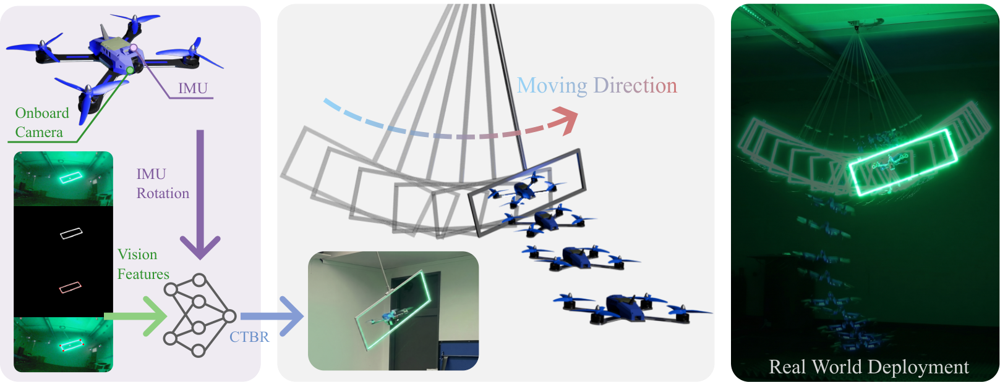

# Learning Visuomotor Quadrotor Flight Through Dynamic Narrow Gaps

<p align="center">
  
</p>

<!--
Links to add once the paper is on arXiv (release alongside the arXiv upload):

<p align="center">
  <a href="ARXIV_URL_HERE">Paper (arXiv)</a> &nbsp;|&nbsp;
  <a href="VIDEO_URL_HERE">Video</a>
</p>
-->

> **Note:** This work has been submitted to a robotics conference and is
> currently under review. The citation will be added once the paper is accepted.

## Overview

This repository contains the code, training configurations, and pretrained
models for learning **visuomotor quadrotor flight through dynamic narrow gaps**.
A quadrotor must fly through a narrow gap — either **static** or **moving**
(pendulum-driven) — using either full **state** information or only onboard
**vision** features.

We compare two learning paradigms:

- **BPTT** — Backpropagation Through Time through a **differentiable simulator**.
  Gradients flow directly through the physics, yielding very high sample
  efficiency: policies learn to cross the gap in seconds (state) to minutes
  (vision).
- **PPO** — A model-free reinforcement learning baseline (state observations
  only).

The project is built on top of the
[rpg_flightning](https://github.com/uzh-rpg/rpg_flightning) differentiable
simulation framework (see [Acknowledgments](#acknowledgments)).


## Installation

JAX only supports GPU acceleration on Linux. On Windows or macOS the code still
runs, but it is significantly slower.

### 1. Create the conda environment

```bash
conda create -n flightning python=3.9
conda activate flightning
```

### 2. Install the `flightning` package

From the root of the repository:

```bash
# install requirements
pip install -r requirements.txt
# install the flightning package (editable)
pip install --use-pep517 -e .
```

## Training

Convenience launchers live in `scripts/`. Each one starts a background training
run (`nohup`) and writes outputs to `runs/`. Training configurations (reward
weights, network sizes, learning-rate schedules) live in
`configs/training_configs.yaml`.

### BPTT (differentiable simulation)

```bash
# Usage: scripts/train_bptt.sh [moving|static] [vision|state] [num_envs]
# Defaults: static gap, state observations, 100 environments.

bash scripts/train_bptt.sh                     # static, state,  100 envs
bash scripts/train_bptt.sh moving              # moving, state,  100 envs
bash scripts/train_bptt.sh static vision 100   # static, vision, 100 envs
bash scripts/train_bptt.sh moving vision 100   # moving, vision, 100 envs
```

### PPO (model-free RL, state only)

```bash
# Usage: scripts/train_ppo.sh [moving|static] [num_envs]
# Defaults: static gap, state observations, 100 environments.
# Note: PPO does not support vision observations.

bash scripts/train_ppo.sh                # static, state, 100 envs
bash scripts/train_ppo.sh moving         # moving, state, 100 envs
bash scripts/train_ppo.sh moving 100     # moving, state, 100 envs
```

### Train everything

To reproduce the full study (all algorithm × gap × observation × env-count
combinations), run them sequentially:

```bash
bash scripts/train_all.sh
```

You can also call the Python entry points directly:

```bash
python experiments/train_bptt_gap_crossing.py -t --num-envs=100 --moving --vision
python experiments/train_ppo_gap_crossing.py  -t --num-envs=1000 --moving
```

## Evaluation

**The pretrained models used for evaluation are already included in this
repository** — there is no need to train anything to reproduce the results.
Four BPTT checkpoints (trained with 100 parallel environments) are committed:

| Configuration   | Checkpoint                                                     |
|-----------------|----------------------------------------------------------------|
| static · state  | `runs/bptt_static_state_envs100/checkpoints/checkpoint_20000`   |
| moving · state  | `runs/bptt_moving_state_envs100/checkpoints/checkpoint_20000`   |
| static · vision | `runs/bptt_static_vision_envs100/checkpoints/checkpoint_20000`  |
| moving · vision | `runs/bptt_moving_vision_envs100/checkpoints/checkpoint_19000`  |

To evaluate all four pretrained policies with the differentiable simulator,
just run:

```bash
bash scripts/evaluate_all.sh
```

This runs 1000 rollouts per configuration, prints the gap-crossing statistics
(success rate, collision events, position/orientation errors), and saves plots
under each run's `plots/` directory. All output is also logged to
`evaluate_all.out`.

For each configuration the script generates:

- a **2D gap-crossing trajectory** plot (all configurations), and
- a **bounding-box heatmap** (vision configurations only).

To evaluate a single checkpoint:

```bash
python experiments/evaluate.py \
    --algo bptt \
    --checkpoint runs/bptt_moving_vision_envs100/checkpoints/checkpoint_19000 \
    --rollouts 1000 \
    --moving --vision
```

Useful flags: `--moving`, `--vision`, `--rollouts N`, `--no-heatmap`,
`--no-plots`, `--show`.

## Repository structure

```
flightning/              # Core package: environments, algorithms, simulation, sensors
experiments/             # Training and evaluation entry points
  ├── train_bptt_gap_crossing.py
  ├── train_ppo_gap_crossing.py
  └── evaluate.py
scripts/                 # Convenience launchers (train_*.sh, evaluate_all.sh)
configs/                 # training_configs.yaml: reward weights & hyperparameters
runs/                    # Training outputs + committed pretrained checkpoints
figs/                    # Figures (teaser, etc.)
```

## Acknowledgments

This project builds on
[rpg_flightning](https://github.com/uzh-rpg/rpg_flightning) —
*"Learning Quadrotor Control From Visual Features Using Differentiable
Simulation"* (Heeg, Song, Scaramuzza, ICRA 2025,
[arXiv:2410.15979](https://arxiv.org/abs/2410.15979)).

Portions of the code are based on
[PureJaxRL](https://github.com/luchris429/purejaxrl) and
[gymnax](https://github.com/RobertTLange/gymnax), licensed under the Apache
License 2.0 (see `THIRD_PARTY_LICENSES/APACHE_LICENSE.txt`).

## Citation

<!--
The paper describing this work is currently under review. Once it is on arXiv /
accepted, add the BibTeX entry here, e.g.:

@article{bianco2026visuomotor,
  title   = {Learning Visuomotor Quadrotor Flight Through Dynamic Narrow Gaps},
  author  = {Bianco, Riccardo and others},
  journal = {arXiv preprint arXiv:XXXX.XXXXX},
  year    = {2026},
}
-->

A citation will be added once the associated paper is available on arXiv.

## License

The code in this project is licensed under the GPL-3.0 license.

Portions of this project are based on code from
[PureJaxRL](https://github.com/luchris429/purejaxrl) and
[gymnax](https://github.com/RobertTLange/gymnax), licensed under the Apache
License 2.0. See `THIRD_PARTY_LICENSES/APACHE_LICENSE.txt` for details.
